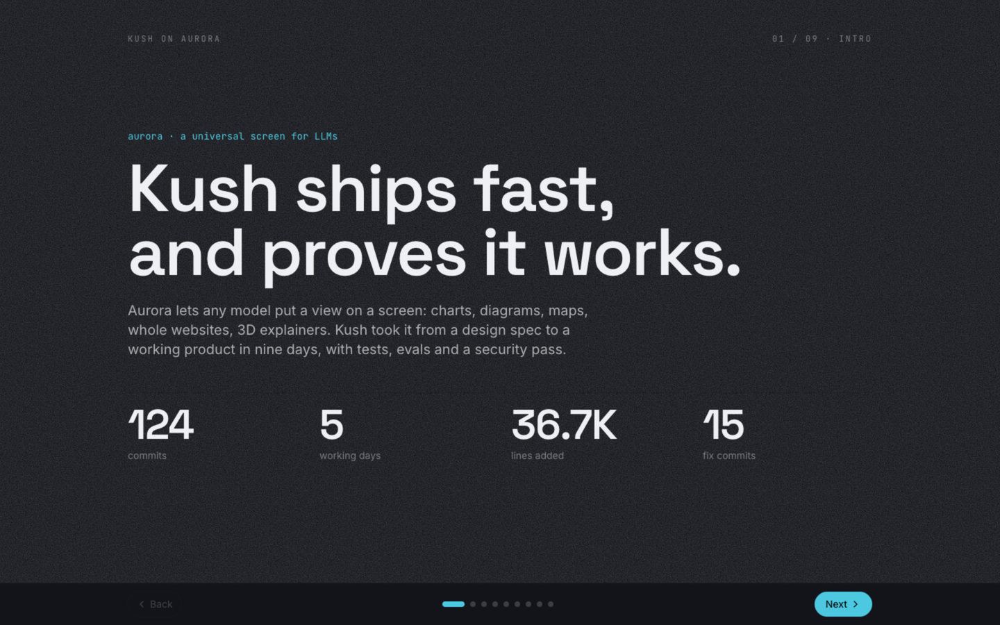
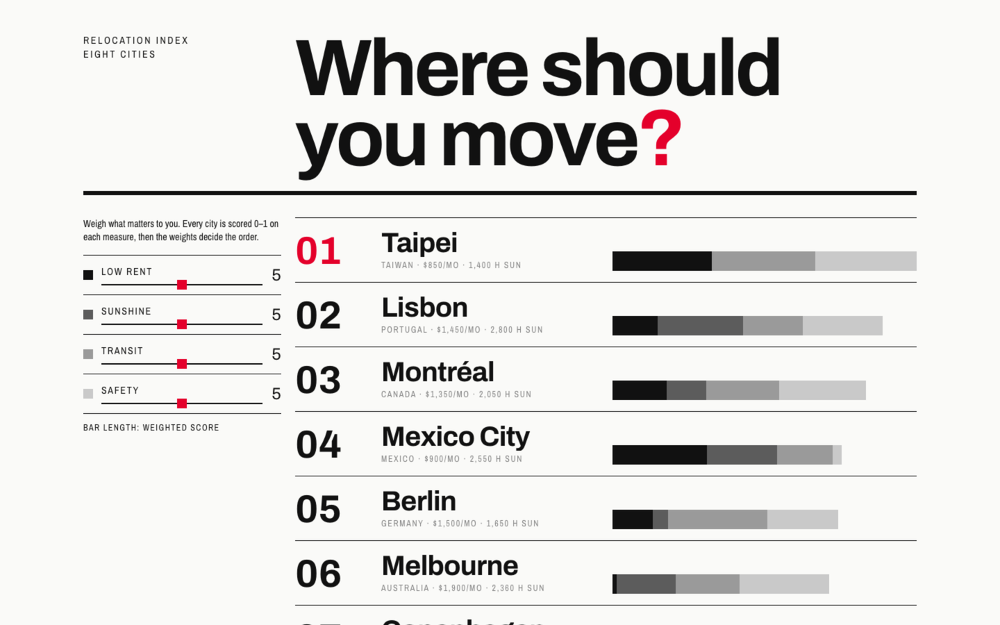
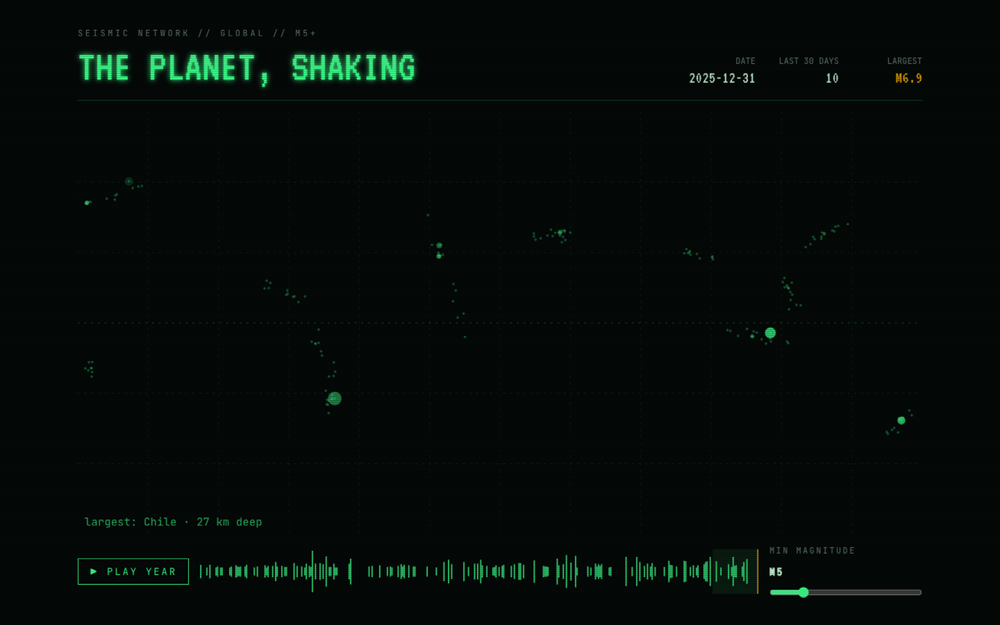
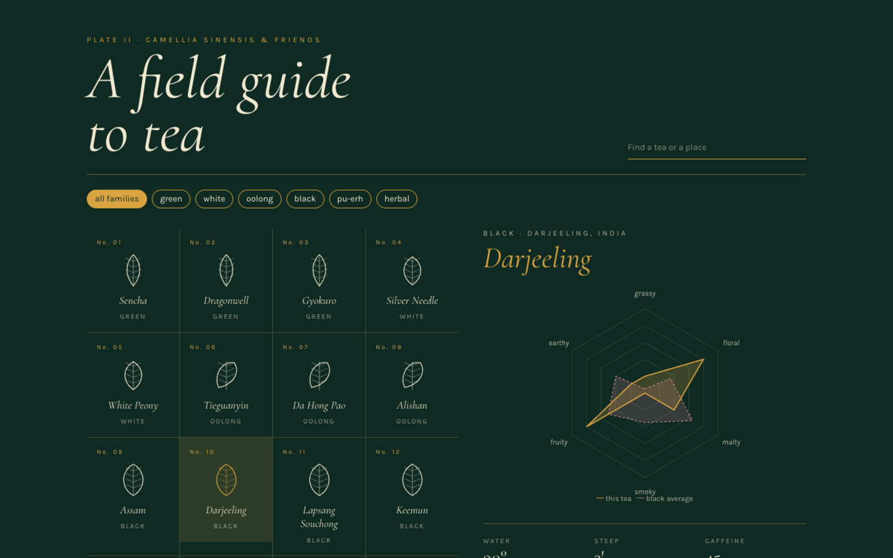
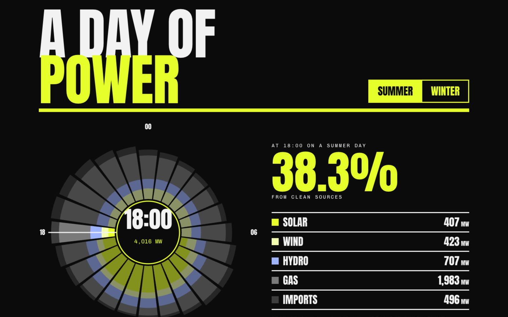
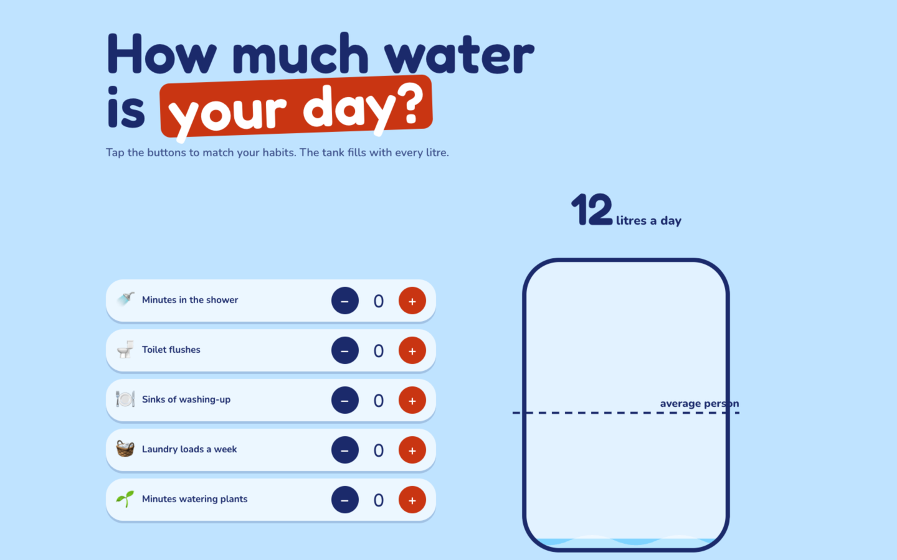
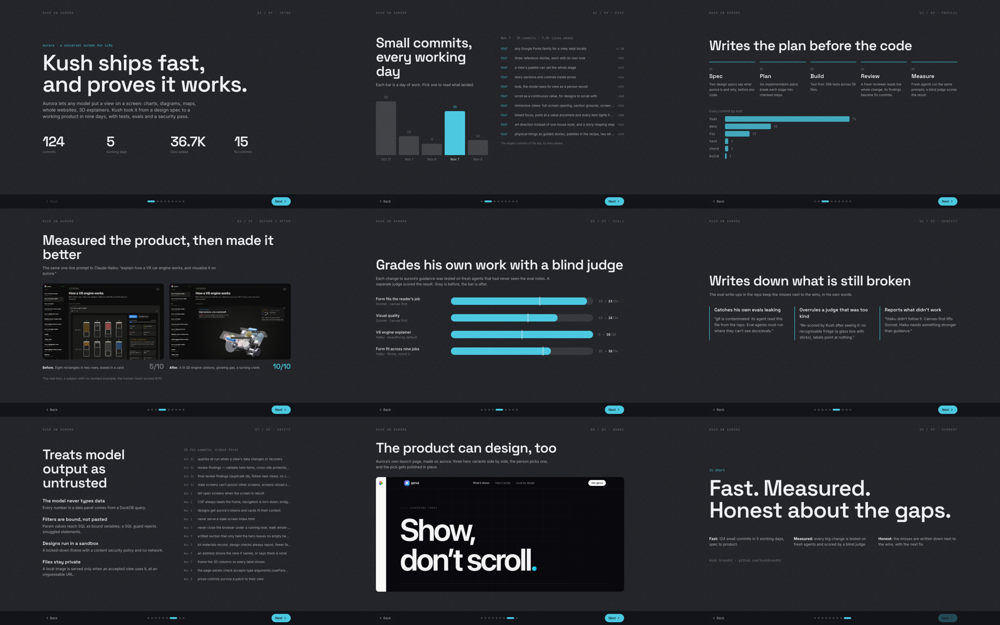

# aurora

**Give your AI a screen.**

Ask Claude a question and you usually get a wall of text. With aurora, it can *show* you instead: a dashboard over your CSV, a diagram of your system, a 3D engine you can turn by hand, a landing page, a slide deck. The model writes the view, and aurora draws it, checks it and tells the model what broke so it can fix it before you look.



**How it works**

1. **Your model sends a view.** A view is JSON: charts, tables, maps, diagrams, or a whole React page. It comes from Claude Code or any MCP harness, built up piece by piece and refined with small patches.
2. **aurora draws it and reports back.** It renders with motion, keeps every version, and returns problems (a broken chart, text that overflows, a 3D scene stuck in a card) so the model can fix them.
3. **You look, explore and share.** Point at a value and it lights up everywhere. Filter, scrub, click through. Run it on your laptop, or host it and send a link.

Numbers in data panels always come from DuckDB queries over your data, so the model never makes them up.

**Five views, five looks.** Each is interactive, and each one's design and layout were chosen for its subject. All five ship with the skill as worked examples. **Click any picture to open the live view** on a hosted aurora: drag, filter and play with it in your browser.

<table>
<tr>
<td width="50%"><a href="https://anchor.tailcc772d.ts.net:10000/v/2gwotucik8qoakzc_b9766f0ce58593dee75629bc0fedd609"></a><br><b>Where should you move?</b> Eight cities, ranked live by the weights you set.</td>
<td width="50%"><a href="https://anchor.tailcc772d.ts.net:10000/v/2gwotucik8qoakzc_2058ce3139ad8791126ac6affa95459e"></a><br><b>The planet, shaking.</b> A year of earthquakes: play it, scrub it, raise the floor.</td>
</tr>
<tr>
<td><a href="https://anchor.tailcc772d.ts.net:10000/v/2gwotucik8qoakzc_4a9a8875b2d570d7d4dda5d52656da4a"></a><br><b>A field guide to tea.</b> Sixteen teas as specimens, with flavour and brewing for each.</td>
<td><a href="https://anchor.tailcc772d.ts.net:10000/v/2gwotucik8qoakzc_9485a41c86735f437d0595a529463906"></a><br><b>A day of power.</b> A city's electricity hour by hour: drag the hand around the day.</td>
</tr>
<tr>
<td><a href="https://anchor.tailcc772d.ts.net:10000/v/2gwotucik8qoakzc_7ed94e4712a8d5b97d760c48b33687df"></a><br><b>How much water is your day?</b> Tap in your habits; the tank fills with every litre.</td>
<td><a href="https://anchor.tailcc772d.ts.net:10000/v/2gwotucik8qoakzc_a31c1f6e566823db717f10511df452bd"></a><br><b>Kush on aurora.</b> A nine-slide deck an agent built from the repo's own history (<a href="#what-it-can-draw">all slides</a>).</td>
</tr>
</table>

- [Quick start (local)](#quick-start-local)
- [Hosted aurora](#hosted-aurora)
- [What it can draw](#what-it-can-draw)
- [Data, filters and media](#data-filters-and-media)
- [Tools and HTTP API](#tools-and-http-api)
- [Config](#config)
- [Develop and test](#develop-and-test)

## Quick start (local)

Requires Node 24.

```bash
npm install && (cd packages/renderer && npm run build)
claude mcp add --scope user aurora -- "$PWD/node_modules/.bin/tsx" "$PWD/packages/server/src/cli.ts" mcp
npm run aurora -- skill     # installs the aurora skill to ~/.claude/skills/aurora
```

Then ask Claude for something visual: "show an overview of projects.csv", "explain how a V8 engine works", "mock up a landing page for this repo". `aurora mcp` starts the shared server on port 4317 if it isn't already running and opens the screen at http://localhost:4317.

The **skill** is aurora's method. It tells the model how to choose a form, pick a look and check its work before it says it's done. It ships with reference files and 14 worked examples, each with its own look.

**No MCP?** Any harness that can write files works. Append JSON lines to `<project>/.aurora/views/<name>.ndjson`: line 1 is a view, and each later line is `{"ops": [...], "baseVersion": N}`. aurora applies each line as it lands and writes `<name>.problems.json` beside it. The folder must be registered, either by an MCP session started there or with `npm run aurora -- watch <project>`.

## Hosted aurora

One server, many people. Each person gets a **workspace key**, a signed token sent as `Authorization: Bearer <key>`. There are no accounts. Their harness talks to `/mcp` over HTTP, and every render returns a **view-only share link** (`/v/<token>`) that opens in any browser.

**Connect** (with a key from whoever runs the server):

```bash
claude mcp add --transport http aurora https://<aurora-host>/mcp --header "Authorization: Bearer <key>"
```

**Claude.ai and ChatGPT** can't send a header. Whoever runs the server makes a **personal link** with `aurora link new --name <name>`: a secret URL, `https://<aurora-host>/mcp/<secret>`, that acts as one workspace. Paste it as the connector URL with **No authentication**. Keep it private; `aurora link revoke <name>` turns it off.

**Get a key** (the server's invite code is required):

```bash
curl -X POST https://<aurora-host>/api/keys -H 'Content-Type: application/json' -d '{"invite":"<invite>"}'
```

**Run your own:** `deploy/README.md` covers Docker and Caddy with automatic TLS on `aurora.<your-domain>`: env vars, smoke test, secret rotation and backups. Hosted mode is `AURORA_MODE=hosted` with `AURORA_SECRET` (32+ characters), `AURORA_INVITE`, `AURORA_PUBLIC_URL` and `AURORA_DATA_DIR` (default `/data`).

How hosted mode differs from local:

| | Local | Hosted |
|---|---|---|
| Who | you | anyone with a key; each key is its own workspace |
| MCP | stdio (`aurora mcp`) | Streamable HTTP at `POST /mcp` |
| Tools | all, below | `render`, `patch`, `status`, `version` |
| Data | files, folders, URLs, inline | inline rows only (no server paths, no fetching) |
| Sharing | your screen | `/v/<token>` view-only links, revocable per view |
| Off | — | composer, folder watching, `look`, `variants`, `events` |

Rotating `AURORA_SECRET` invalidates every key. Not yet in hosted mode: uploads, per-viewer filter state, screenshots (`look`), quotas.

## What it can draw

**Forms, chosen by the reader's job.** The skill picks a form before it picks parts: an answer, a story, an explainer, a monitor, an explorer, a comparison, a tool, a reference or a pitch. It can blend them when that serves the reader. It also chooses a direction (palette, fonts, surface) per view, so two views don't look alike.

**Layouts.** `grid` (12 columns) · `tabs` · `story` (the first item stays pinned while steps scroll past and drive it, with `"story": {"focus", "state"}`) · `reel` (panels that slide sideways). `immersive: true` turns a view into one designed page, with a full-screen opening and edge-to-edge sections that can take `height: "screen"` and a `background`.

**Catalog components.** `kpi` (with sparkline) · `chart` (Vega-Lite) · `table` · `text` · `json` · `diagram` (Mermaid) · `architecture` (ELK layout, icons, animated edges) · `graph` (Cytoscape, 1,000+ nodes) · `map` (MapLibre, works offline) · `timeline` · `cards` · `media` · `code` (Shiki, diffs) · `callout` · `steps`. `npm run aurora -- gallery` puts every component's example on screen. Heavy engines load only when a view uses them.

**Design canvas: anything else.** A `design` item is a multi-file React + Tailwind (or HTML/JS) project. It is compiled in the browser and runs in a sandboxed iframe with bundled libraries: React, Motion, lucide, three.js and react-three-fiber/drei, d3, GSAP. There is no network access. `display: "page"` makes a design the whole screen. Designs iterate with `editFile` find/replace, offer 2–3 **variants** for the person to pick from, and send clicks back (`aurora.send` → the `events` tool). Compile errors (file:line), runtime errors, blocked requests and layout problems come back as problems.

**`aurora/kit`** is the toolkit inside designs:
- 3D scenes with real materials (`Scene`, `Metal`, `Glass`, `Glow`), labels and stages
- story and scroll hooks (`useStory`, `useScroll`, `useScrub`)
- controls (`ControlBar`, `Scrubber`, `Grab`, `PhaseDial`)
- data-bound parts (`Bars`, `Picker`, `SearchTable`, `Tabs`, `fmt`)
- procedural **surfaces** (grain, paper, blueprint, dots, contour, halftone, thermal, clouds, iridescent)

Everything uses aurora's tokens, so it follows the view's palette and light/dark theme.

**Everything is linked.** Pointing at a value anywhere lights it up everywhere: bars dim, table rows mark, prose highlights, design parts glow. Designs can read and set the view's filters too.

**Versions.** The version chip lists every version. Picking one previews it, and **Use this version** makes it current as a new version, so nothing is lost. The model's next patch builds on it and its result says `rebased: true`. Views persist under `~/.aurora/views/<id>/v<N>.json`, keeping the last 200 views or 30 days, whichever keeps more. `AURORA_VIEWS_DIR` overrides the folder.

**A deck, built by an agent.** Asked to make the case for how aurora was built, an agent produced a nine-slide deck as a single `design`. It has Back/Next controls, a commit-activity chart you can click, before/after screenshots, eval scores and a list of fix commits. Every number comes from queries over the repo's git log and eval write-ups.



Examples: [explaining this repo](docs/screenshots/2b-explain.png) · [a CSV analysis with filters](docs/screenshots/2b-analysis.png) · [three hero variants](docs/screenshots/2c-variants.png) → [the picked one, polished](docs/screenshots/2c-landing.png).

## Data, filters and media

**Data.** CSV, TSV, JSON, NDJSON, Parquet, `.md`/`.txt` files or folders (loaded as a `(name, body)` table), `http(s)` URLs, or inline rows. `profile` describes a dataset before the model writes queries.

**Filters.** A view's `params` (`select`, `range`, `daterange`, `search`) become a filter row. Queries read them as bound DuckDB variables (`$region`, `$price_min`/`$price_max`, `$when_from`/`$when_to`), so values are never pasted into SQL. Changing a filter re-runs only the queries that use it.

**Media** is displayed, never generated. `media` and `cards` show existing images and videos by path or URL. A local file is served only after an accepted view references it, at an unguessable `/media/<token>` URL, with Range requests for video and SVGs sandboxed.

## Tools and HTTP API

**MCP tools (local):**
- `render`, `patch` (ops by id) and `status`
- `profile`
- `version` (history, pick, revert an item)
- `variants`
- `events` (long-poll design clicks)
- `look` (screenshots of the screen, for the model to see its work)
- `compose` (aurora's own composer, a fallback)

**HTTP:**
- `POST /api/views {view}` · `POST /api/views/:id/patch {ops, baseVersion?}`
- `GET /api/views/:id` · `GET /api/views/:id/status` · `GET /api/views/:id/history` · `GET /api/views/:id/versions/:n`
- `POST /api/views/:id/pick {version}` · `POST /api/views/:id/revert {itemId, version}`
- `POST /api/views/:id/params {name, value}` · `POST /api/views/:id/variants {variants}` · `GET /api/views/:id/events?after&wait`
- `POST /api/views/:id/share {rotate?}` (hosted)
- `POST /api/profile {data}` · `POST /api/watch {dir}` · `POST /api/gallery` · `POST /api/render`
- `GET /api/health` · `GET /media/<token>`

The screen picks up changes over `GET /ws`.

**aurora's own composer** (a fallback when no model is driving): `npm run aurora -- render sales.csv --intent "monthly revenue by region"` profiles the data and composes a view with the configured provider. That's your Claude Code subscription by default, Ollama offline, or any OpenAI-compatible server.

## Config

`~/.aurora/config.json` (all optional), overridden by env:

| key | env | default |
|---|---|---|
| `port` | `AURORA_PORT` | `4317` |
| `provider` | `AURORA_PROVIDER` | `claude` (Claude Code subscription), `ollama` (local), or `openai` (any OpenAI-compatible server) |
| `model` | `AURORA_MODEL` | `sonnet` for claude, `qwen3:8b` for ollama |
| `effort` | | `low` (claude provider) |
| `ollamaUrl` | `AURORA_OLLAMA_URL` | `http://127.0.0.1:11434` |
| `baseUrl` | `AURORA_BASE_URL` | — (required for `openai`, e.g. `http://localhost:8000/v1`) |
| `apiKey` | `AURORA_API_KEY` | — |
| `models` | | per-task models, e.g. `{"compose": "auto", "repair": "fast"}` |
| `jsonMode` | | `schema` (default), `object`, or `none` |
| | `AURORA_MODE` | `hosted` for hosted mode (see above) |
| | `AURORA_NO_OPEN=1` | never open a browser |
| | `AURORA_FAKE_PROVIDER=1` | canned composition, no model |
| | `AURORA_DEBUG_DIR=<dir>` | save raw output of incomplete compositions |

With an OpenAI-compatible router, every call is tagged `compose` or `repair`, so repairs can go to a small, fast model:

```json
{ "provider": "openai", "baseUrl": "http://localhost:8000/v1", "model": "auto", "models": { "repair": "fast" } }
```

## Develop and test

```text
packages/spec      view schema, components, surfaces, palettes
packages/engine    validation and patching
packages/renderer  the screen (React) and the design sandbox (aurora/kit)
packages/server    HTTP/WS server, MCP (stdio + HTTP), hosted mode, skill
```

```bash
npx vitest run                                 # unit + integration
(cd packages/renderer && npx playwright test)  # browser tests (installed Chrome)
scripts/hosted-smoke.sh <url> <invite>         # end-to-end check of a hosted server
```

Design docs and plans live in `docs/specs/` and `docs/superpowers/`. Evals of the skill across models are in `docs/evals/`.

## License

MIT, © 2026 KushGrandhi. See `LICENSE`.
