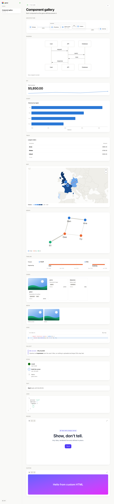

# aurora

A universal screen for LLMs: whichever model you are working with composes a view (KPIs with sparklines, charts, tables and filters; architecture and Mermaid diagrams; network graphs, maps, timelines; code, images, video, cards, steps, callouts, prose, JSON), and aurora validates it, draws it with spring motion, keeps every version and reports problems back. Views are built up part by part and refined in place with patches by id. Numbers in data-bound panels always come from DuckDB queries; the model never types data.

Design: `docs/specs/2026-10-31-aurora-canvas-design.md` (Plan 2) · `docs/specs/2026-10-31-aurora-design.md` (Plan 1) · Plans: `docs/superpowers/plans/`



## Use it from Claude Code (or any MCP harness)

```bash
npm install && (cd packages/renderer && npx vite build)
claude mcp add --scope user aurora -- "$PWD/node_modules/.bin/tsx" "$PWD/packages/server/src/cli.ts" mcp
npm run aurora -- skill        # writes ~/.claude/skills/aurora/SKILL.md, generated from the component registry
```

Then ask for something visual ("show an overview of projects.csv", "explain the auth flow on screen"). `aurora mcp` starts the shared server on port 4317 if it isn't running and registers the session's folder for file streaming. Tools: `render`, `patch`, `status`, `profile`, `version` (history / pick / revertItem), `variants`, `events` and `compose` (aurora's own composer, a fallback).

**File streaming** works from any harness that can write files: append JSON lines to `<project>/.aurora/views/<name>.ndjson` (line 1 a view, later lines `{"ops": [...], "baseVersion": N}`); aurora applies each line as it lands and writes `<name>.problems.json` beside it. The folder must be registered: by an MCP session started there, or `npm run aurora -- watch <project>`.

**Design canvas: build anything.** Beyond the catalog, the LLM can put a whole website, interactive explainer, game, 3D scene or mockup on the screen: a `design` item is a multi-file React + Tailwind (or HTML/JS) project, compiled in the browser (Sucrase) and run in a sandboxed iframe with bundled libraries (React, Motion, lucide, three.js, d3, GSAP, Inter; no network, no CDN). `display: "page"` makes it the whole screen; cards get a desktop/tablet/phone switcher. It iterates with `editFile` find/replace ops, offers 2–3 **variants** side by side for the person to pick (`variants` tool; the pick becomes the current version), and hears clicks back: the page calls `aurora.send(name, payload)` and the LLM reads them with the `events` tool (long-poll with `waitMs`). Compile errors (file:line), runtime errors, blocked network requests and stuck pages come back as problems. Example: a launch page for aurora itself, three hero variants, the person's pick polished ([variants](docs/screenshots/2c-variants.png), [result](docs/screenshots/2c-landing.png)).

**Components.** `kpi` (optional `sparkline`), `chart` (Vega-Lite), `table`, `text`, `json`, `diagram` (Mermaid), `architecture` (ELK-laid-out system picture with icons and animated edges), `graph` (Cytoscape network, 1,000+ nodes), `map` (MapLibre with bundled country shapes: points, routes, choropleth; OSM street tiles optional, works offline), `timeline`, `cards`, `media`, `code` (Shiki, diffs), `callout`, `steps`. The skill documents each one from the registry; `npm run aurora -- gallery` (or `POST /api/gallery`) puts every component's example on the screen. Heavy engines load only when a view uses them.

**Filters.** A view's `params` (`select`, `range`, `daterange`, `search`) become a filter row above its sections. Queries read them as DuckDB-bound variables (`$region`, `$price_min`/`$price_max`, `$when_from`/`$when_to`) — values are never pasted into SQL. Changing a filter re-runs only the queries that use it; `status` shows the current values and `POST /api/views/:id/params {name, value}` sets one.

**Media** is displayed, never generated: `media` and `cards` show existing images and videos by absolute path or URL. A local file is served only because an accepted view references it, at an unguessable `/media/<token>` URL (Range requests for video, SVG sandboxed); everything else is a 404.

Real runs (`claude -p` over MCP): explaining this repo built an architecture diagram, a Mermaid sequence of a render call, build steps and a code excerpt ([screenshot](docs/screenshots/2b-explain.png)); a `projects.csv` analysis built a language filter, KPIs with sparklines, a timeline, a chart and a table that all follow the filter ([all](docs/screenshots/2b-analysis.png), [TypeScript only](docs/screenshots/2b-analysis-filtered.png)).

**HTTP**: `POST /api/views {view}` · `POST /api/views/:id/patch {ops, baseVersion?}` · `GET /api/views/:id` · `GET /api/views/:id/status` · `GET /api/views/:id/history` · `GET /api/views/:id/versions/:n` · `POST /api/views/:id/pick {version}` · `POST /api/views/:id/revert {itemId, version}` · `POST /api/views/:id/params {name, value}` · `POST /api/views/:id/variants {variants}` · `GET /api/views/:id/events?after&wait` · `POST /api/profile {data}` · `POST /api/watch {dir}` · `POST /api/gallery` · `GET /media/<token>`. The screen picks up everything over `GET /ws`.

On the screen, the version chip lists every version; choosing one previews it and **Use this version** makes it current (a new version, so nothing is lost). A caller's next patch builds on it and its result says `rebased: true`.

Views persist as JSON under `~/.aurora/views/<id>/v<N>.json` (last 200 views or 30 days, whichever keeps more; `AURORA_VIEWS_DIR` overrides the folder).

## Plan 1 entry: aurora composes from data + intent

Requires Node 24 and the `claude` CLI logged in (the default provider composes views on your Claude Code subscription: Sonnet at low effort, ~2 s to the first panel). For offline use, set `provider` to `ollama` and pull a model (default `qwen3:8b`).

```bash
npm install
(cd packages/renderer && npx vite build)     # build the screen once
npm run aurora -- serve                       # http://localhost:4317
npm run aurora -- render sales.csv --intent "monthly revenue by region"
npm run aurora -- render orders=orders.parquet docs=./notes/   # several named datasets
```

`render` starts the server in-process if none is running and opens the screen if no tab is connected.

Inputs: CSV, TSV, JSON, NDJSON, Parquet, `.md`/`.txt` files or directories (loaded as a `(name, body)` table), or `http(s)` URLs.

HTTP: `POST /api/render {"data": "<path>" | {"name": "<path>", ...} | {"inline": [...]}, "intent": "..."}` → `{renderId, url}`; the composed view is an ordinary v2 view (`renderId` is its view id), so it can be patched and versioned like any other.

## Config

`~/.aurora/config.json` (all optional), overridden by env:

| key | env | default |
|---|---|---|
| `port` | `AURORA_PORT` | `4317` |
| `model` | `AURORA_MODEL` | `sonnet` for claude, `qwen3:8b` for ollama |
| `ollamaUrl` | `AURORA_OLLAMA_URL` | `http://127.0.0.1:11434` |
| `provider` | `AURORA_PROVIDER` | `claude` (Claude Code subscription), `ollama` (local, offline), or `openai` (any OpenAI-compatible server, e.g. the LLM routing server) |
| `effort` | | `low` (claude provider; higher effort thinks first and is slower) |
| `baseUrl` | `AURORA_BASE_URL` | — (required for `openai`, e.g. `http://localhost:8000/v1`) |
| `apiKey` | `AURORA_API_KEY` | — |
| `models` | | per-task model names, e.g. `{"compose": "auto", "repair": "fast"}` |
| `jsonMode` | | `schema` (default), `object`, or `none` if the backend lacks JSON-schema output |
| | `AURORA_FAKE_PROVIDER=1` | canned composition, no model |
| | `AURORA_NO_OPEN=1` | never open a browser |
| | `AURORA_DEBUG_DIR=<dir>` | save the raw model output of any incomplete composition there |

### Using the LLM routing server

```json
// ~/.aurora/config.json
{ "provider": "openai", "baseUrl": "http://localhost:8000/v1", "model": "auto", "models": { "repair": "fast" } }
```

Every call is tagged as a `compose` or a `repair`, so the router can send repairs to a small fast model and full compositions to a bigger one.

## Test

```bash
npx vitest run                               # unit + integration
(cd packages/renderer && npx playwright test) # browser smoke test (uses installed Chrome)
npx tsx scripts/latency.ts [model]           # real-model timings
```

## Measured latency (MacBook Air M4, 16 GB, qwen3:8b Q4_K_M, Ollama 0.18.2)

`npx tsx scripts/latency.ts`, 2026-10-31:

| input | profile | default view | first LLM panel | total | panels | cache-hit total |
|---|---|---|---|---|---|---|
| sales.csv (240 rows) | 49 ms | 74 ms | 18.1 s (incl. cold model load) | 43.8 s | 4 | 37 ms |
| events.parquet (1M rows) | 107 ms | 120 ms | 10.7 s | 108.9 s | 9 | 120 ms |
| docs directory | 24 ms | 28 ms | 4.7 s | 16.2 s | 3 | 19 ms |

What these show:
- Profiling, the default view and cache hits all beat their targets (300 ms / 400 ms / 150 ms).
- The first LLM panel misses the 3 s local target. Breakdown on sales.csv: prompt 1,622 tokens, prefill 2.9 s cold → 0.1 s once Ollama has cached the static prefix; generation ~18.7 tok/s; ~600 output tokens per view. Constrained decoding costs nothing measurable (18.7 vs 18.5 tok/s for plain JSON).
- So the bottleneck is generation speed × output length. That's for Plan 4 (model choice via `aurora eval`, smaller/faster models, a more compact part format), not fixed here.
